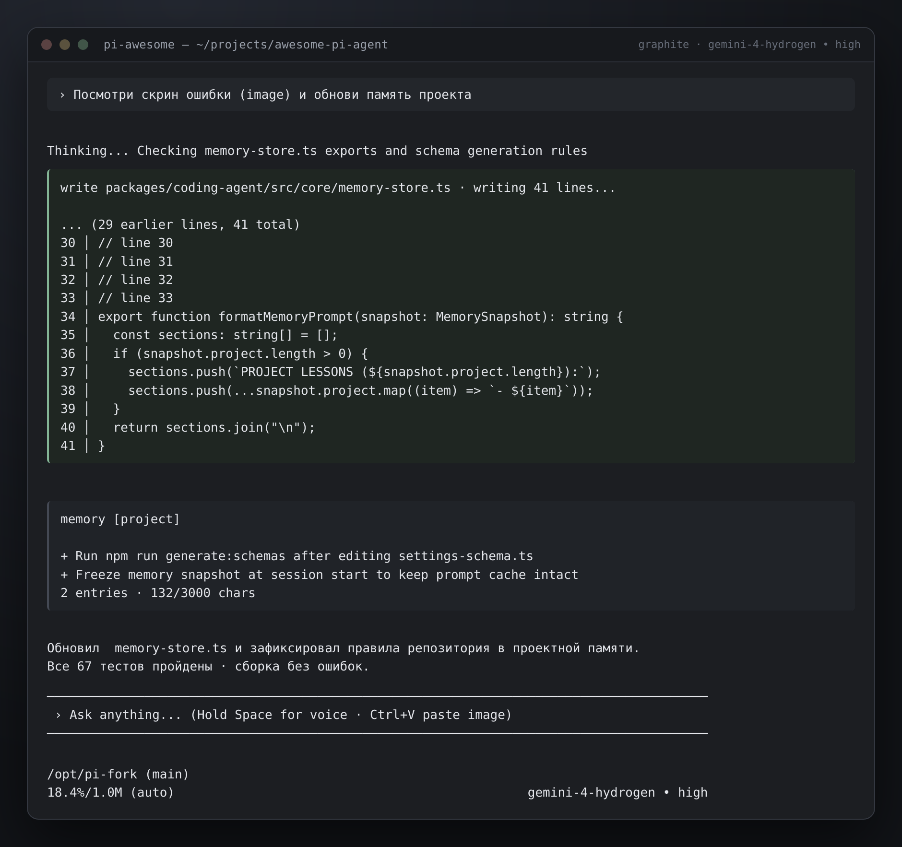
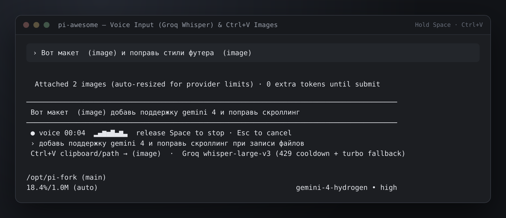
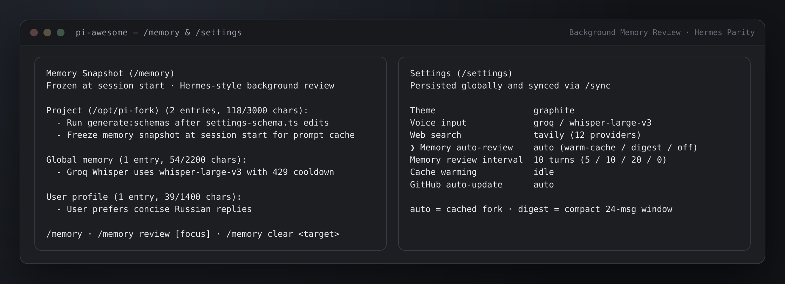

# awesome-pi-agent (`pi-awesome`)

> **A fast, minimalist, cross-platform AI coding agent built on [Pi](https://github.com/earendil-works/pi) by [Gl1ch5555](https://github.com/Gl1ch5555)** — strict graphite TUI with zero clutter, Experimental Code Mode (`codemode`) + Zero-Token Code Map (`/map` & `outline()`), Recent-6 model quick-switch (`Alt+L` / `Alt+1..6`), parallel Web UI, encrypted Cloud Sync, hold-Space Groq Whisper voice input, `Ctrl+V` images, Hermes-style background memory, Scoped Proxy, and prebuilt binaries for Linux, macOS, Windows, and Termux.

[](https://github.com/Gl1ch5555/awesome-pi-agent/releases/tag/latest)
[](#quick-install)
[](#core-features)
[](https://github.com/Gl1ch5555)

[English](#experimental--unique-features) · [Русская версия](#русская-версия)

<p align="center">
  
</p>

---

## Experimental & Unique Features

`pi-awesome` focuses on **speed and token efficiency** — giving you and the model zero-overhead local tools and instant workflows instead of wasting context or round-trips.

### 1. Experimental Code Mode (`codemode`)
- Enable in `/settings` → **Experimental Code Mode** (or `PI_EXPERIMENTAL_CODE_MODE=1`).
- Instead of making 5–10 separate LLM turns for reading files, grepping, and running checks, the model writes a compact JavaScript script executed in an isolated **QuickJS WASM sandbox**.
- Scripts can chain and parallelize `tools.read`, `tools.grep`, `tools.find`, `tools.bash`, `tools.edit`, `tools.write`, persist branch-scoped JSON state via `store(key, value)` / `load(key)`, discover deferred/MCP tools (`searchTools()`, `describeTool()`), and call non-LLM classifiers/image models (`models.*`).
- Only the script's final output enters the LLM context — intermediate tool noise stays out of your token bill.

### 2. Zero-Token Code Map (`/map` & `outline()` in `codemode`)
- Built-in zero-dependency local symbol parser (`TS/JS`, `Python`, `Go`, `Rust`, `C/C++`, `Java/C#`, `Ruby`, `PHP`, `Markdown`) that runs in milliseconds on your CPU with **0 LLM tokens**.
- **For you (`/map [path]`):** Instantly prints a compact skeleton of a file or directory (classes, interfaces, functions, methods, exports with exact line numbers) right into the TUI.
- **For the model (`await outline(path?, opts)` inside `codemode`):** Before reading a 1,000+ line file, the model inspects its outline for ~200 tokens and then reads only the exact 40–60 lines it needs — saving **60–85% of input tokens** on medium/large codebases.

### 3. Recent 6 Models Quick-Switch (`/model`, `Alt+1..6`, `/swap` / `Alt+L`)
- Automatically tracks your last **6 used models** (`recentModels`) and pins them at the very top of `/model` (`Ctrl+L`) and the Web UI model picker with `[1]`–`[6]` slots.
- **No search needed:** Press `Alt+1..6` inside `/model`, run `/model 1`..`/model 6`, or press **`Alt+L`** (or `/swap`) anywhere in the editor to instantly toggle between your current and previous model (e.g., jumping between a heavy reasoning model and a fast coding model in one keystroke).

### 4. Question Test Mode (`ask_questions`)
- Enabled by default (toggleable in `/settings`). Allows the agent to ask **1–40 compact test-style multiple-choice questions** at once in both TUI (`QuizDialogComponent`) and Web UI.
- Answers are returned in a compact format without echoing all options back into LLM context.

### 5. Parallel Local Web UI (`--web` / `/web`)
- Run a responsive browser / mobile PWA workspace alongside your terminal TUI (`AgentSessionRuntime` + real-time SSE, zero desync).
- Includes collapsible project/session sidebar, per-project `+` new chat, session archiving, `/` commands, `@` project file picker, drag-and-drop & `Ctrl+V` images, Groq Whisper voice dictation, clickable context ring, and a 4-tab `SettingsModal` synced with the terminal.

### 6. UI Packs, Themes & TUI Presets
- Switchable in `/settings` with instant live preview and `/sync` support:
  - **Themes:** `graphite` (default), `claude-code`, `codex-cli`, `opencode`, `kiro-cli`, `gemini-cli`, `dark`, `light`, `catppuccin-mocha`, `tokyo-night`, `dracula`, `nord`, `rose-pine`.
  - **TUI Styles:** `native`, `rounded`, `compact`, `opentui`, `sageveil`, `claude-code`, `codex-cli`, `opencode`, `kiro-cli`, `gemini-cli`.
  - **Independent Accent (`themeAccent`):** `default`, `slate`, `sage`, `amber`, `coral`, `cyan`, `violet`, `rose`, `mono`.
  - **One-Click UI Packs:** Complete theme + accent + layout bundles (`pi-graphite`, `claude-code`, `codex-cli`, `opencode`, `kiro-cli`, `gemini-cli`, `sageveil`, `tokyo-opentui`, `catppuccin-rounded`).

### 7. Scoped Proxy (`/settings` → `Proxy`)
- Configure HTTP / HTTPS / SOCKS5 / SOCKS5h proxies with independent per-feature toggles: **AI**, **Voice**, **Sync**, and **Web** — plus a built-in live connection test.

---

## Core Features

- **Minimalist Graphite TUI** — zero emojis in TUI output, compact `<model> • <thinkingLevel>` footer, live tail-following line-numbered `write`/`edit` streaming previews, and `1m 5s` duration formatting for long-running tools.
- **Gemini 4 & OpenAI-Compat Support** — proper `google.thinking_config`, `<think>` filtering, `thought_signature` preservation across `tool_calls`, `Shift+Tab` reasoning cycling, and automatic `maxTokens` inference.
- **Hermes-Style Memory (`/memory`) & Skills (`skill_manage`)** — three isolated stores (`project`, `memory`, `user`) frozen at session start to preserve 100% LLM prompt cache, plus asynchronous background memory/skill review every `N` turns.
- **Hold-Space Voice Input** — live chunked transcription via Groq Whisper (`whisper-large-v3` with automatic `whisper-large-v3-turbo` fallback and 429 rate-limit protection).
- **`Ctrl+V` Image Attachments** — paste clipboard screenshots or file paths as `(image)` markers on Linux, macOS, WSL, and Windows.
- **Custom Providers (`/providers`)** — stepwise `name → baseUrl → apiKey → GET /v1/models → checkbox selection` setup.
- **Encrypted Cloud Sync (`/sync`)** — sync settings, API keys, models, memory, skills, prompts, themes, and plugins across devices (with automatic fallback mirrors and onboarding restore).
- **Web Search (`web_search` / `web_fetch`)** — Tavily by default + 11 additional providers with automatic fallback.
- **Side-by-Side Self-Update (`/update`) & Changelog** — 4-stream parallel HTTP Range downloads from GitHub Releases (`latest`), side-by-side Windows updates in `versions/`, and automatic **"What's New"** changelog display after updating.

---

## Screenshots

### Voice Input (Groq Whisper) & `Ctrl+V` Images
<p align="center">
  
</p>

### Provider Manager (`/providers`) & Cloud Sync (`/sync`)
<p align="center">
  
</p>

### Memory (`/memory`) & Background Review in `/settings`
<p align="center">
  
</p>

---

## Quick Install

Installers download **prebuilt compiled binaries** directly from [GitHub Releases (`latest`)](https://github.com/Gl1ch5555/awesome-pi-agent/releases/tag/latest) (Linux x64/arm64, macOS arm64/x64, Windows x64/arm64) using 4-stream parallel HTTP Range downloads. No Node.js required for end users.

### Linux / macOS / Termux

```bash
curl -fsSL https://raw.githubusercontent.com/Gl1ch5555/awesome-pi-agent/main/install.sh | bash
```

With a GitHub token:

```bash
export PI_GH_TOKEN="<YOUR_GITHUB_TOKEN>"
curl -fsSL -H "Authorization: token $PI_GH_TOKEN" \
  https://raw.githubusercontent.com/Gl1ch5555/awesome-pi-agent/main/install.sh | bash
```

### Windows (PowerShell)

```powershell
irm "https://raw.githubusercontent.com/Gl1ch5555/awesome-pi-agent/main/install.ps1" | iex
```

With a GitHub token:

```powershell
$env:PI_GH_TOKEN = "<YOUR_GITHUB_TOKEN>"
$h = @{ Authorization = "token $env:PI_GH_TOKEN" }
irm -Headers $h "https://raw.githubusercontent.com/Gl1ch5555/awesome-pi-agent/main/install.ps1" | iex
```

- Install directory: `~/.pi-awesome` (Linux/macOS) or `%USERPROFILE%\.pi-awesome` (Windows)
- Launch command: `pi-awesome` (or `pi-awesome --web` for Web UI)

---

## Keybindings & Commands

### Keybindings
- **`Hold Space`** — live voice dictation via Groq Whisper (`Esc` cancels; short tap types a space)
- **`Ctrl+V`** — paste image from clipboard or image path as `(image)`
- **`Ctrl+L`** — open model selector (recent 6 models pinned on top; `Alt+1..6` for instant pick)
- **`Alt+L`** — instant swap to the previous recent model (no menu)
- **`Ctrl+P` / `Shift+Ctrl+P`** — cycle scoped models
- **`Shift+Tab`** — cycle reasoning level (`off` / `minimal` / `low` / `medium` / `high` / `xhigh`)
- **`Ctrl+O`** — expand/collapse tool output
- **`Ctrl+T`** — toggle thinking blocks
- **`!command`** — run a local shell command directly from the editor

### Slash Commands
- **`/map [path]`** — zero-token symbol outline of a file or directory
- **`/swap`** — switch immediately to the previous recently used model
- **`/model [query | 1..6]`** — select model or quick-pick a recent slot
- **`/providers`** — manage custom OpenAI-compatible providers and `/v1/models`
- **`/sync`** — encrypted Cloud Sync (`push`, `pull`, `status`)
- **`/web [start | stop | status]`** — control the parallel localhost Web UI
- **`/memory`** — inspect, review (`/memory review [focus]`), or clear (`project|memory|user`) memory
- **`/settings`** — themes, UI packs, Experimental Code Mode, proxy, voice, memory, search, updates
- **`/changelog`** — view `pi-awesome` release notes
- **`/update`** — check and install updates from GitHub Releases (with changelog preview)

---

## Local Development & Build

Requires **Node.js >= 22.19** and **git**.

```bash
git clone https://github.com/Gl1ch5555/awesome-pi-agent.git
cd awesome-pi-agent
npm install --ignore-scripts
npm run hydrate:model-data
npm run build:offline
node packages/coding-agent/dist/bundle/cli.js
```

If you edit `settings-schema.ts` or `settings-defaults.ts`, regenerate JSON schemas before building/testing:

```bash
npm --prefix packages/coding-agent run generate:schemas
npx tsc -p packages/coding-agent/tsconfig.build.json --noEmit
npm --prefix packages/coding-agent exec -- vitest run test/awesome-features.test.ts test/config-schemas.test.ts
```

---
---

# Русская версия

> **Минималистичный, быстрый и кроссплатформенный AI coding-agent на базе [Pi](https://github.com/earendil-works/pi) от [Gl1ch5555](https://github.com/Gl1ch5555)** — строгий графитовый TUI без лишнего шума, Experimental Code Mode (`codemode`) + карта кода без траты токенов (`/map` и `outline()`), быстрое переключение последних 6 моделей (`Alt+L` / `Alt+1..6`), параллельный Web UI, зашифрованный Cloud Sync, голосовой ввод по удержанию `Space` (Groq Whisper), вставка картинок по `Ctrl+V`, память в стиле Hermes Agent, Scoped Proxy и готовые бинарники для Linux, macOS, Windows и Termux.

---

## Экспериментальные и уникальные фичи

Главный упор в `pi-awesome` — **скорость разработки и экономия токенов**: локальные инструменты с нулевым оверхедом и мгновенное управление без лишних ходов LLM.

### 1. Experimental Code Mode (`codemode`)
- Включается в `/settings` → **Experimental Code Mode** (или через `PI_EXPERIMENTAL_CODE_MODE=1`).
- Вместо 5–10 отдельных ходов на чтение файлов, поиск и прогон проверок модель пишет короткий JS-скрипт, который выполняется в изолированной **QuickJS WASM-песочнице**.
- Скрипты умеют объединять и распараллеливать `tools.read`, `tools.grep`, `tools.find`, `tools.bash`, `tools.edit`, `tools.write`, сохранять состояние между шагами (`store(key, value)` / `load(key)`), находить скрытые/MCP-инструменты (`searchTools()`, `describeTool()`) и вызывать модели классификации/генерации (`models.*`).
- В контекст модели попадает только итоговый вывод скрипта, а весь промежуточный шум остаётся за кадром.

### 2. Карта кода без траты токенов (`/map` и `outline()` в `codemode`)
- Встроенный локальный парсер символов без внешних зависимостей (`TS/JS`, `Python`, `Go`, `Rust`, `C/C++`, `Java/C#`, `Ruby`, `PHP`, `Markdown`), который работает за миллисекунды на CPU с **0 LLM-токенов**.
- **Для тебя (`/map [путь]`):** мгновенно выводит в TUI компактный скелет файла или директории (классы, интерфейсы, функции, методы, экспорты с точными номерами строк).
- **Для модели (`await outline(path?, opts)` внутри `codemode`):** прежде чем читать большой файл на 1000+ строк целиком, модель за ~200 токенов смотрит его карту и вычитывает только нужные 40–60 строк. На средних и крупных проектах это экономит **60–85% входных токенов**.

### 3. Последние 6 моделей сверху и быстрое переключение (`/model`, `Alt+1..6`, `/swap` / `Alt+L`)
- Автоматически запоминает **6 последних использованных моделей** (`recentModels`) и поднимает их в самый верх списка в `/model` (`Ctrl+L`) и в Web UI с метками `[1]`–`[6]`.
- **Без поиска каждый раз:** в окне `/model` можно сразу нажать `Alt+1..6`, в чате написать `/model 1`..`/model 6`, а клавиша **`Alt+L`** (или команда `/swap`) в один клик перебрасывает туда-обратно между текущей и предыдущей моделью.

### 4. Режим тест-опроса (`ask_questions`)
- Включён по умолчанию (переключается в `/settings`). Позволяет агенту задать от **1 до 40 компактных тестовых вопросов** с вариантами ответа за один раз — как в TUI (`QuizDialogComponent`), так и в Web UI.
- В контекст модели возвращаются только выбранные ответы без повторного дублирования всех вариантов.

### 5. Параллельный локальный Web UI (`--web` / `/web`)
- Адаптивный браузерный интерфейс и мобильный PWA, полностью синхронизированный с терминальной сессией (`AgentSessionRuntime` + SSE в реальном времени).
- Сворачиваемый сайдбар проектов и сессий, кнопка `+` для нового чата в проекте, архивация сессий, поддержка `/` команд, `@` файлов проекта, drag-and-drop и `Ctrl+V` картинок, голосовой ввод, кольцо контекста и 4-вкладочный `SettingsModal`.

### 6. UI-паки, темы и пресеты вёрстки
- Мгновенное переключение в `/settings` с синхронизацией через `/sync`:
  - **Темы:** `graphite` (по умолчанию), `claude-code`, `codex-cli`, `opencode`, `kiro-cli`, `gemini-cli`, `dark`, `light`, `catppuccin-mocha`, `tokyo-night`, `dracula`, `nord`, `rose-pine`.
  - **Стили TUI:** `native`, `rounded`, `compact`, `opentui`, `sageveil`, `claude-code`, `codex-cli`, `opencode`, `kiro-cli`, `gemini-cli`.
  - **Акцент (`themeAccent`):** `default`, `slate`, `sage`, `amber`, `coral`, `cyan`, `violet`, `rose`, `mono`.
  - **Готовые UI-паки:** применяют тему, акцент и стиль TUI в один клик (`pi-graphite`, `claude-code`, `codex-cli`, `opencode`, `kiro-cli`, `gemini-cli`, `sageveil`, `tokyo-opentui`, `catppuccin-rounded`).

### 7. Scoped Proxy (`/settings` → `Proxy`)
- Настройка HTTP / HTTPS / SOCKS5 / SOCKS5h прокси с раздельными переключателями по трафику: **AI**, **Voice**, **Sync** и **Web** — плюс встроенный тест подключения.

---

## Основные возможности

- **Графитовый TUI без лишнего шума** — ноль эмодзи в интерфейсе, компактный футер `<model> • <thinkingLevel>`, живой стриминг `write`/`edit` с нумерацией строк и таймеры в формате `1m 5s`.
- **Поддержка Gemini 4 и OpenAI-compat** — корректный `google.thinking_config`, фильтрация `<think>`, сохранение `thought_signature` в `tool_calls`, переключение thinking по `Shift+Tab` и автоопределение `maxTokens`.
- **Память в стиле Hermes Agent (`/memory`) и скиллы (`skill_manage`)** — три изолированных хранилища (`project`, `memory`, `user`), заморозка снэпшота на старте сессии (100% сохранение LLM prompt cache) и фоновое ревью раз в `N` ходов.
- **Голосовой ввод по удержанию `Space`** — потоковая расшифровка через Groq Whisper (`whisper-large-v3` с fallback на `whisper-large-v3-turbo` и защитой от `429`).
- **Вставка картинок по `Ctrl+V`** — скриншоты из буфера обмена и пути к файлам превращаются в `(image)` на Linux, macOS, WSL и Windows.
- **Менеджер провайдеров (`/providers`)** — пошаговое добавление OpenAI-совместимых endpoint'ов с загрузкой моделей через `GET /v1/models`.
- **Зашифрованный Cloud Sync (`/sync`)** — перенос настроек, ключей, моделей, памяти, скиллов, промптов, тем и плагинов между устройствами.
- **Автообновление (`/update`) и Changelog** — 4-поточная параллельная загрузка из GitHub Releases (`latest`), side-by-side обновление на Windows в `versions/` и автоматический показ списка изменений (**What's New**) сразу после обновления.

---

## Быстрая установка

Установщики скачивают **готовый скомпилированный бинарник** из [GitHub Releases (`latest`)](https://github.com/Gl1ch5555/awesome-pi-agent/releases/tag/latest) в 4 параллельных потока.

### Linux / macOS / Termux

```bash
curl -fsSL https://raw.githubusercontent.com/Gl1ch5555/awesome-pi-agent/main/install.sh | bash
```

### Windows (PowerShell)

```powershell
irm "https://raw.githubusercontent.com/Gl1ch5555/awesome-pi-agent/main/install.ps1" | iex
```

- Папка установки: `~/.pi-awesome` (Linux/macOS) или `%USERPROFILE%\.pi-awesome` (Windows)
- Команда запуска: `pi-awesome` (или `pi-awesome --web` для Web UI)

---

## Горячие клавиши и команды

### Горячие клавиши
- **`Hold Space`** — запись голоса через Groq Whisper (`Esc` отменяет; короткий тап вводит пробел)
- **`Ctrl+V`** — вставка картинки из буфера обмена или по пути как `(image)`
- **`Ctrl+L`** — выбор модели (последние 6 сверху; `Alt+1..6` — мгновенный выбор)
- **`Alt+L`** — мгновенный переброс на предыдущую модель без меню
- **`Ctrl+P` / `Shift+Ctrl+P`** — цикл по выбранным моделям
- **`Shift+Tab`** — уровень reasoning (`off` / `minimal` / `low` / `medium` / `high` / `xhigh`)
- **`Ctrl+O`** — развернуть/свернуть вывод инструментов
- **`Ctrl+T`** — показать/скрыть блоки рассуждений (`thinking`)
- **`!command`** — выполнить локальную команду прямо из редактора

### Slash-команды
- **`/map [путь]`** — карта символов файла или директории (0 токенов)
- **`/swap`** — переключиться на предыдущую модель
- **`/model [поиск | 1..6]`** — выбор модели или быстрый слот `1..6`
- **`/providers`**, **`/sync`**, **`/web`**, **`/memory`**, **`/settings`**, **`/changelog`**, **`/update`**

---

## Ссылки

- Репозиторий: [Gl1ch5555/awesome-pi-agent](https://github.com/Gl1ch5555/awesome-pi-agent)
- Автор: [Gl1ch5555](https://github.com/Gl1ch5555)
- Базовый проект: [earendil-works/pi](https://github.com/earendil-works/pi)
