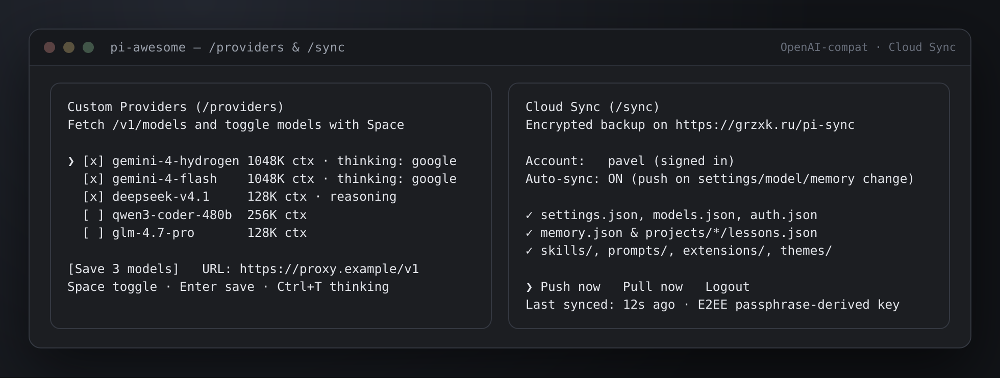

# awesome-pi-agent

> Минималистичный терминальный AI coding-agent на базе [Pi](https://github.com/earendil-works/pi): строгий графитовый TUI без лишнего шума, Gemini 4, голосовой ввод по удержанию `Space`, вставка картинок по `Ctrl+V`, фоновая память в стиле Hermes Agent, менеджер провайдеров и зашифрованный Cloud Sync.

[](https://github.com/Gl1ch5555/awesome-pi-agent/releases/tag/latest)
[](#быстрая-установка)
[](#возможности)

<p align="center">
  
</p>

---

## Возможности

- **Графитовый TUI и живой streaming-вывод** — тема `graphite` по умолчанию, ноль эмодзи, компактный футер `<model> • <thinkingLevel>` без лишнего имени провайдера, а также нумерация строк и скроллинг за хвостом при потоковой записи файлов (`write`).
- **Поддержка Gemini 4 & OpenAI-compat** — корректный `google.thinking_config`, фильтрация `<think>`, сохранение `thought_signature` при `tool_calls` и переключение уровней рассуждений по `Shift+Tab`.
- **Фоновая память в стиле Hermes Agent (`/memory`)** — три изолированных хранилища (`project`, `memory`, `user`), замороженный снэпшот на старте сессии (100% сохранение LLM prompt cache) и автоматическое фоновое ревью раз в `N` ходов без навязчивых инструкций в основном системном промпте.
- **Голосовой ввод по удержанию `Space`** — потоковая расшифровка через Groq Whisper (`whisper-large-v3`) с осциллограммой и живым превью, защитой от `429` rate-limit и автоматическим fallback на `whisper-large-v3-turbo`.
- **Вставка картинок по `Ctrl+V`** — скриншоты из буфера обмена, скопированные файлы или пути к изображениям превращаются в компактные маркеры `(image)` и уходят в модель при отправке (Linux и Windows).
- **Менеджер провайдеров (`/providers`)** — пошаговое добавление OpenAI-совместимых endpoint'ов с автозагрузкой списка моделей через `GET /v1/models` и выбором чекбоксами.
- **Зашифрованный Cloud Sync (`/sync`)** — перенос настроек, API-ключей, моделей, памяти, скиллов, промптов, тем и плагинов между машинами через `https://grzxk.ru/pi-sync` + восстановление прямо в мастере первого запуска.
- **Веб-поиск (`web_search` / `web_fetch`)** — Tavily по умолчанию + ещё 11 провайдеров с автоматическим fallback.
- **Автообновление из GitHub Releases (`/update`)** — готовые prebuilt-сборки для Linux, macOS и Windows (на Windows — side-by-side обновление в `versions/`, без блокировки запущенного `.exe`).

---

## Скриншоты

### Голосовой ввод (Groq Whisper) и `Ctrl+V` картинки

<p align="center">
  
</p>

### Менеджер провайдеров (`/providers`) и Cloud Sync (`/sync`)

<p align="center">
  
</p>

### Память (`/memory`) и фоновое ревью в `/settings`

<p align="center">
  
</p>

---

## Быстрая установка

Требуется **Node.js >= 22.19** и **git**.

### Linux / macOS

Прямая установка:

```bash
curl -fsSL https://raw.githubusercontent.com/Gl1ch5555/awesome-pi-agent/main/install.sh | bash
```

Или через GitHub-токен:

```bash
export PI_GH_TOKEN="<YOUR_GITHUB_TOKEN>"
curl -fsSL -H "Authorization: token $PI_GH_TOKEN" \
  https://raw.githubusercontent.com/Gl1ch5555/awesome-pi-agent/main/install.sh | bash
```

Установщики сразу скачивают **готовый скомпилированный бинарник** из [GitHub Releases (`latest`)](https://github.com/Gl1ch5555/awesome-pi-agent/releases/tag/latest) (собранный в GitHub Actions для Linux x64/arm64, macOS arm64/x64 и Windows x64/arm64). Node.js и ручная сборка не требуются; при отсутствии релиза срабатывает автоматический fallback на сборку из исходников.

Папка установки: `~/.pi-awesome` (Linux/macOS) и `%USERPROFILE%\.pi-awesome` (Windows).
Команда запуска: `pi-awesome`.

### Windows (PowerShell)

Прямая установка:

```powershell
irm "https://raw.githubusercontent.com/Gl1ch5555/awesome-pi-agent/main/install.ps1" | iex
```

Или через GitHub-токен:

```powershell
$env:PI_GH_TOKEN = "<YOUR_GITHUB_TOKEN>"
$h = @{ Authorization = "token $env:PI_GH_TOKEN" }
irm -Headers $h "https://raw.githubusercontent.com/Gl1ch5555/awesome-pi-agent/main/install.ps1" | iex
```

Установщик скачает готовый `pi-windows-x64.zip` / `pi-windows-arm64.zip` и добавит команду `pi-awesome` в пользовательский `PATH`.

---

## Как устроена память и фоновое ревью

Модель работы памяти построена по схеме **Hermes Agent**:

1. **Без навязчивости в системном промпте** — в основном диалоге нет агрессивной инструкции «постоянно анализируй ошибки». Если вы сами просите *«запомни это»*, агент сразу вызывает инструмент `memory`.
2. **Три изолированных хранилища (`memory-store.ts`)**:
   - `project` (`projects/<repo>--<hash>/lessons.json`, лимит `3000` символов) — команды сборки/тестов, правила и грабли конкретного `.git`-репозитория;
   - `memory` (`memory.json`, лимит `2200` символов) — глобальные заметки об окружении, путях и инструментах;
   - `user` (`memory.json`, лимит `1400` символов) — профиль и устойчивые предпочтения пользователя.
3. **Замороженный снэпшот на всю сессию** — блок `<agent_memory>` загружается один раз при старте сессии и не меняется посреди диалога, чтобы префикс системного промпта оставался побайтово стабильным для LLM prompt cache.
4. **Фоновое ревью раз в `N` ходов (`memory-review.ts`)**:
   - по умолчанию запускается в фоне после каждого 10-го завершённого пользовательского хода (приоритет всегда у пользователя — новый ввод мгновенно отменяет фоновый прогон);
   - режим **`auto`** (по умолчанию) — повторяет текущий префикс сессии (warm prompt cache) с dispatch-whitelist'ом только на инструмент `memory` (без изменения `tools[]` в JSON-схеме);
   - режим **`digest`** — сворачивает старые ходы в компактную выжимку и оставляет последние 24 сообщения (экономично для прокси без prompt caching);
   - оба режима и интервал (`5 / 10 / 20 / 0`) настраиваются в `/settings`, а ручной запуск доступен через `/memory review [focus]`.

---

## Горячие клавиши и команды

### Горячие клавиши

- **`Hold Space`** — запись голоса через Groq Whisper (`Esc` отменяет запись; короткий тап вводит обычный пробел)
- **`Ctrl+V`** — вставка изображения из буфера обмена или по пути файла как `(image)`
- **`Ctrl+L`** — выбор модели
- **`Ctrl+P` / `Shift+Ctrl+P`** — быстрое переключение между сохранёнными моделями
- **`Shift+Tab`** — переключение уровня reasoning (`off` / `minimal` / `low` / `medium` / `high` / `xhigh`)
- **`Ctrl+O`** — развернуть/свернуть вывод инструментов
- **`Ctrl+T`** — показать/скрыть блоки рассуждений (`thinking`)
- **`!command`** — выполнить локальную shell-команду прямо из редактора

### Slash-команды

- **`/providers`** — добавить кастомного OpenAI-совместимого провайдера (`Имя -> URL -> API Key -> /v1/models`) или обновить модели
- **`/sync`** — облачная синхронизация (`push`, `pull`, `status`, автосинхронизация настроек, ключей, моделей, памяти и плагинов)
- **`/memory`** — просмотр сохранённой памяти; `/memory review [focus]` — ручное ревью сессии; `/memory clear project|memory|user` — очистка
- **`/settings`** — настройки темы, памяти и фонового ревью, голоса, поиска, cache warming и автообновлений
- **`/voice`** — ручное управление голосовым вводом (`/voice on|off|toggle`)
- **`/update`** — проверка и установка обновлений с GitHub Releases
- **`/model`**, **`/thinking`**, **`/login`**, **`/tree`**, **`/resume`**, **`/compact`**, **`/new`**, **`/quit`**

---

## Голосовой ввод (Groq Whisper)

- Модель по умолчанию: `whisper-large-v3` (при `429` rate-limit включается общий cooldown между сессиями и автоматический fallback на `whisper-large-v3-turbo` для финальной расшифровки).
- Интервал живых чанков по умолчанию: `5000 мс` (настраивается, с безопасным минимумом `4000 мс` под лимит Groq 20 RPM).
- На Linux/Termux автоматически выбирается доступный бэкенд (`parecord` / `arecord` / `ffmpeg` с проверкой `pulse`/`alsa`/`oss` / `sox`), на Windows — встроенный `winmm.dll` через PowerShell или `ffmpeg`.
- Ключ задаётся в мастере первого запуска, в `/settings` -> **Voice input**, или через переменную `GROQ_API_KEY`.

---

## Поисковые провайдеры (`web_search` / `web_fetch`)

Выбираются в мастере первого запуска или в `/settings` -> **Web search & fetch**:

1. `tavily` (`TAVILY_API_KEY`) — провайдер по умолчанию + extract для `web_fetch`
2. `brave` (`BRAVE_API_KEY`)
3. `exa` (`EXA_API_KEY`)
4. `serper` (`SERPER_API_KEY`)
5. `perplexity` (`PERPLEXITY_API_KEY`)
6. `firecrawl` (`FIRECRAWL_API_KEY`)
7. `jina` (`JINA_API_KEY`, работает и без ключа)
8. `linkup` (`LINKUP_API_KEY`)
9. `serpapi` (`SERPAPI_API_KEY`)
10. `google_cse` (`GOOGLE_SEARCH_API_KEY` + `cx`)
11. `duckduckgo` (без ключа, резервный fallback)
12. `searxng` (`SEARXNG_URL`, self-hosted)

---

## Локальная разработка и сборка

Требуется **Node.js >= 22.19** и **git**.

```bash
git clone https://github.com/Gl1ch5555/awesome-pi-agent.git
cd awesome-pi-agent
npm install --ignore-scripts
npm run hydrate:model-data
npm run build:offline
node packages/coding-agent/dist/bundle/cli.js
```

Если редактировались `settings-schema.ts` или `settings-defaults.ts`, перед сборкой и тестами обновите JSON-схемы:

```bash
npm --prefix packages/coding-agent run generate:schemas
npx tsc -p packages/coding-agent/tsconfig.build.json --noEmit
npm --prefix packages/coding-agent exec -- vitest run test/awesome-features.test.ts test/config-schemas.test.ts
```
